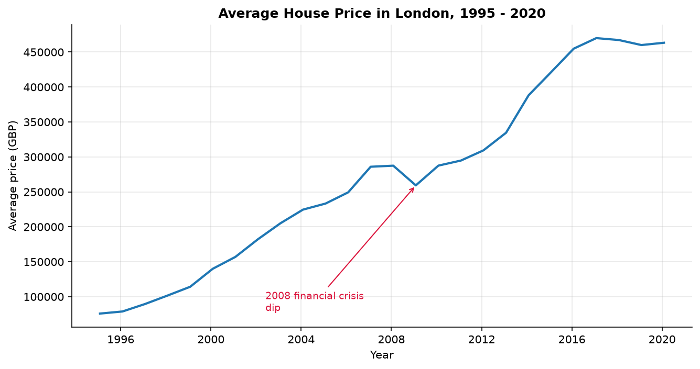
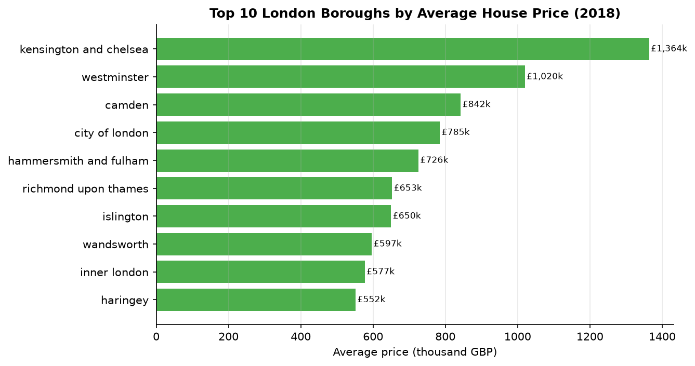

# Huang Ziqi — Data Science Portfolio

## About Me

Hi! I am **Huang Ziqi** (MC641033), a graduate student at the University of Macau
studying Data Science. I enjoy turning raw data into clear, meaningful stories
through exploratory analysis and visualization.

## Technical Skills

- **Languages & Tools:** Python, Pandas, NumPy, Matplotlib, Jupyter Notebook, Git/GitHub
- **Data Analysis:** data cleaning, exploratory data analysis (EDA), time-series trends, correlation analysis
- **Visualization:** Matplotlib, Seaborn, Plotly, Dash (learning)
- **Others:** SQL basics, statistics fundamentals

## Project Showcase

### London Housing Market Analysis (1995 - 2020)

**Research question:** How have average house prices in London evolved from 1995 to 2020, and how do price levels differ across boroughs?

**Findings:** London's average house price rose from about GBP 76k in 1995 to
GBP 463k in early 2020 (+511%), with a visible dip during the 2008 financial
crisis. The most expensive borough in 2018 was Kensington and Chelsea
(GBP ~1.36M) while the least expensive was North East (GBP ~128k). A mild
positive correlation (r ~ 0.29) exists between borough-level house prices and
monthly crime counts.

- **Project repository:** [github.com/your-username/data-science-project](https://github.com/your-username/data-science-project)
- **Status:** Completed

## Contact

- University of Macau, CISC7204 Data Science and Data Visualization
- Email: mc64103@um.edu.mo
